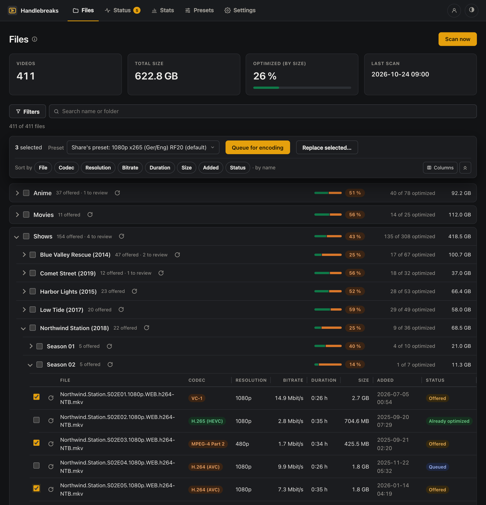
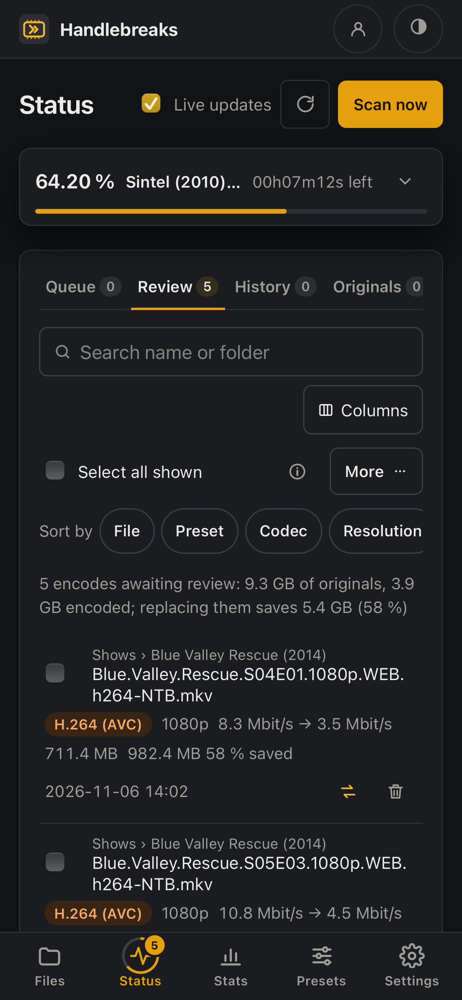
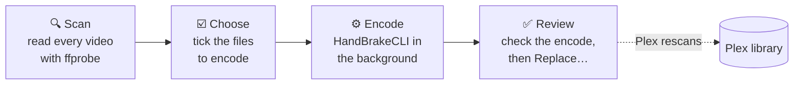

<div align="center">

<picture>
  <source media="(prefers-color-scheme: dark)" srcset="docs/logo-dark.svg">
  
</picture>

# Handlebreaks

**Shrink your Plex library: H.264 → H.265, semi-automatic, with you in control.**

[](https://github.com/madotha/handlebreaks/releases/latest) [](https://github.com/madotha/handlebreaks/actions/workflows/docker.yml) [](https://github.com/madotha/handlebreaks/pkgs/container/handlebreaks) [&replace=%241&label=HandBrakeCLI&color=e5a00d)](https://handbrake.fr) [](https://www.python.org) [](LICENSE)

[Quick start](#quick-start-docker) · [Wiki](https://github.com/madotha/handlebreaks/wiki) · [Changelog](CHANGELOG.md) · [Releases](https://github.com/madotha/handlebreaks/releases) · [Docker image](https://github.com/madotha/handlebreaks/pkgs/container/handlebreaks)

</div>

Handlebreaks converts movies and TV episodes in a Plex library from H.264 (and other older codecs) to H.265/HEVC with HandBrakeCLI. It finds the candidates, you pick what gets encoded, it encodes in the background, and it only replaces an original when you say so, keeping it as a backup by default.

<p align="center">
  
  
</p>
<p align="center"><em>The Files page on a computer and the Status page on a phone (demo data).</em></p>

## Features

- **You decide what gets encoded:** tick files or whole folders; nothing is queued, replaced or deleted on its own.
- **Safe replacing:** **Replace…** puts an encode into the library in place of its original, keeps the original as a backup by default and never overwrites another file.
- **Plex stays in sync:** after a replace, Plex rescans the folder and Handlebreaks checks that it picked up the new file.
- **Every HandBrake setting:** presets per share, edited in the web UI with every setting of the newest HandBrake app, or imported from it.
- **Live status:** queue with drag-and-drop order, progress, history, statistics and notifications when encodes, replaces and scans finish.
- **On your phone:** a layout made for phones, and it installs as an app on the home screen.
- **Looks the way you like:** light or dark, six accent colors, text size, a compact layout and more contrast.
- **Built for a NAS:** scans resume after an interruption, a share that goes offline pauses the work instead of failing it, and automatic rescans find new files.
- **Easy to run:** a prebuilt Docker image for Intel and ARM, or natively on macOS for the fastest encoding.

## How it works



1. **Scan** the library: one or more shares (library folders, e.g. on different NAS shares), each with its own preset. Each video is read with ffprobe (codec, resolution, duration, bitrate). Files that are already H.265/AV1, poor release types, files already encoded or queued and files you skipped are sorted out; everything else is **offered**.
2. **Choose** which files to encode: tick them on the web UI's Files page, or pass their numbers to `encoding.py queue`.
3. **Encode:** a worker runs HandBrakeCLI in the background with the file's preset and puts the result into the output folder, only once the encode succeeded.
4. **Review** the finished files. **Replace…** moves an encode into the library in place of its original and refreshes Plex.

More in [How it works](https://github.com/madotha/handlebreaks/wiki#how-it-works) in the wiki.

## Quick start (Docker)

The fastest way to try it. Tested on macOS with Docker Desktop; Linux with Docker Engine should work the same way but isn't documented yet.

**1. Check the requirements**

- [Docker Desktop](https://www.docker.com/products/docker-desktop/) (or Docker Engine with Compose), running
- Your Plex library reachable as a folder on this machine, e.g. a NAS share mounted at `/Volumes/Media` (macOS: Finder → Go → Connect to Server, `smb://nas/Media`)
- A folder with enough free space for finished encodes (the output folder). H.265 files are usually 30–60 % smaller than the H.264 originals, so plan for about half the size of what you encode at a time.

**2. Download two files.** The image is prebuilt (for Intel and Apple silicon / ARM), so this is all you need:

```bash
mkdir handlebreaks && cd handlebreaks
curl -fsSLO https://raw.githubusercontent.com/madotha/handlebreaks/main/docker-compose.yml
curl -fsSL -o .env https://raw.githubusercontent.com/madotha/handlebreaks/main/.env.example
```

**3. Set two paths** in `.env`:

```bash
HOST_MEDIA_DIR="/Volumes/Media"                    # the folder that contains your library folders
HOST_ENCODED_DIR="/Users/you/Movies/_ENCODED"      # where finished encodes go (created if missing)
```

**4. Start it** and open the web UI:

```bash
docker compose up -d                               # downloads the image the first time
open http://127.0.0.1:7979                         # Linux: xdg-open, or just open it in a browser
```

**5. First run** in the web UI:

1. **Settings → Shares & scans**: replace the two example shares with your folders. A library folder `/Volumes/Media/Movies` is `/media/Movies` inside the container. Each folder needs a green ✓.
2. **Scan now.** The Status page shows that it's running.
3. **Files**: tick files or whole folders and click **Queue for encoding**. Progress is on the **Status** page.
4. Check the finished files in the output folder, then put them into the library with **Replace…** (see below) or move them yourself.

<details>
<summary><b>How long does the first scan take?</b></summary>

The first scan reads every file with ffprobe; for a large library this takes a while (roughly 30–60 minutes for 70,000 files over the network). Later scans only read new or changed files. A scan saves its ffprobe results as it goes, so if it is interrupted (restart, unreachable NAS), the next scan resumes with the remaining files.
</details>

<details>
<summary><b>Replacing originals from Docker</b></summary>

To put an encode into the library in place of the original, Docker needs write access to the library: remove `:ro` from the `/media` line in `docker-compose.yml`, then run `docker compose up -d` again and use **Replace…**. Otherwise, move the files yourself. See [Replacing originals](https://github.com/madotha/handlebreaks/wiki/Replacing-Originals), also for connecting Plex.
</details>

To use it on your phone or install it as an app, see [On a phone](https://github.com/madotha/handlebreaks/wiki/Web-UI#on-a-phone). For more details, the native macOS setup (faster encoding) and the mixed setup, see [Choose a setup](#choose-a-setup) and the [wiki](https://github.com/madotha/handlebreaks/wiki).

## Choose a setup

| | A: native on macOS | B: Docker | C: Docker + native encoding |
|---|---|---|---|
| Runs on | macOS | macOS (Docker Desktop) | macOS (Docker Desktop) |
| Encoding | HandBrakeCLI on the Mac, all CPU cores, Apple AAC | HandBrakeCLI (Linux) in Docker's VM, limited to the CPUs Docker Desktop may use | Native, like A |
| Web UI, scan | On the Mac (Python venv) | In the container | In the container |
| Install effort | Homebrew packages, Python venv, launchd agents | Docker Desktop and two downloaded files, prebuilt image | Both A and B |
| Instructions | [Setup A](https://github.com/madotha/handlebreaks/wiki/Setup-A-Native-macOS) | [Quick start](#quick-start-docker), [Setup B](https://github.com/madotha/handlebreaks/wiki/Setup-B-Docker) | [Setup C](https://github.com/madotha/handlebreaks/wiki/Setup-C-Docker-and-Native-Encoding) |

If you're unsure, use **B** to try it out, or **A** for the fastest encoding (Docker on a Mac encodes about a third slower, see [Performance](https://github.com/madotha/handlebreaks/wiki/Performance)). Other operating systems aren't documented yet.

**Requirements:** the library reachable as a folder on the Mac (see [Mounting the library](https://github.com/madotha/handlebreaks/wiki/Mounting-the-Library)), enough free space in the output folder, and for A and C: Python 3.9+, HandBrakeCLI and ffmpeg (`brew install handbrake ffmpeg`).

<details>
<summary><b>Set it up with an AI coding agent</b></summary>

If you use an AI coding agent that can run commands on your machine (e.g. Claude Code), you can let it do the setup. Start it in an empty folder and paste this prompt (also on the wiki's [Choose a setup](https://github.com/madotha/handlebreaks/wiki/Choose-a-Setup#set-it-up-with-an-ai-coding-agent) page). It asks you for everything that depends on your environment before changing anything:

> Set up "Handlebreaks" (Plex encoding automation) from `https://github.com/madotha/handlebreaks.git` on this machine. Clone it, and clone its wiki (`https://github.com/madotha/handlebreaks.wiki.git`) next to it. Read the README.md and the wiki pages Choose-a-Setup, Mounting-the-Library, Configuration and the Setup page of the setup we choose, completely, and follow them; don't invent steps that aren't in them.
>
> Before you install or configure anything, check my system (operating system, CPU, free disk space, and whether Docker, Homebrew, Python 3.9+, HandBrakeCLI and ffmpeg are installed), then ask me, one topic at a time:
>
> 1. Which setup to use: A (native on macOS), B (Docker) or C (Docker + native encoding on a Mac). Recommend one based on what you found and explain why in one sentence.
> 2. Where my Plex library is: the mounted folder(s), and how they're mounted (e.g. SMB or NFS from a NAS). List the subfolders you find there and ask me which ones should become shares, with which display names, and whether any share needs a different preset.
> 3. The output folder for finished encodes. Check that it exists or can be created and tell me how much free space it has.
> 4. Optional settings: Obsidian notes folder, time zone, web UI port, automatic rescan interval, and whether to connect Plex (PLEX_URL). If I want Plex, tell me how to find my Plex token, but let me enter it myself under Settings → Plex in the web UI. Never print, log or repeat the token.
>
> Then install the missing requirements for the chosen setup (ask before installing anything), create `.env` and/or `config.env` from the templates with my answers, start the tool, and verify it: the web UI opens, every folder under Settings shows a green check mark, and a first scan starts. Don't queue encodes, replace files or change anything in my library; show me how to do that myself instead. Finish with a short summary: what you set up, where the config files are, and how to stop, update and uninstall it.
</details>

## FAQ

**Does it change my originals?**
Only when you click **Replace…** for a file. Even then the original is kept as a backup by default (in `<output folder>/.replaced/`), and a replace never overwrites another file. Scanning and encoding only read the library.

**Do I need Plex?**
No. Handlebreaks works on any folder of videos. With `PLEX_URL` and `PLEX_TOKEN` set, it also refreshes Plex after a replace and checks that Plex picked up the new file.

**How much space does it save?**
H.265 files are usually 30–60 % smaller than H.264 originals at the same quality, depending on the source and the preset. The Stats page and the Status page show what your encodes saved.

**Does it run on Linux or Windows?**
The Docker image runs on Linux (Intel and ARM) the same way as on macOS, but that setup isn't documented yet. Windows isn't tested.

**Can I open it from other devices?**
Yes, with `WEB_BIND=0.0.0.0` in `.env` (Docker) or `webui.py --host 0.0.0.0` (native), but the web UI has no login yet, so only do that on a network you trust and never expose it to the internet. See [Security](#security).

## Documentation

The [wiki](https://github.com/madotha/handlebreaks/wiki) describes the latest release:

- **Setup:** [Choose a setup](https://github.com/madotha/handlebreaks/wiki/Choose-a-Setup), [Performance](https://github.com/madotha/handlebreaks/wiki/Performance), [A: native on macOS](https://github.com/madotha/handlebreaks/wiki/Setup-A-Native-macOS), [B: Docker](https://github.com/madotha/handlebreaks/wiki/Setup-B-Docker), [C: Docker + native encoding](https://github.com/madotha/handlebreaks/wiki/Setup-C-Docker-and-Native-Encoding), [Mounting the library](https://github.com/madotha/handlebreaks/wiki/Mounting-the-Library)
- **Using it:** [Web UI](https://github.com/madotha/handlebreaks/wiki/Web-UI), [Command line](https://github.com/madotha/handlebreaks/wiki/Command-Line), [Scanning](https://github.com/madotha/handlebreaks/wiki/Scanning), [Replacing originals](https://github.com/madotha/handlebreaks/wiki/Replacing-Originals) (and connecting Plex), [Restarts and offline shares](https://github.com/madotha/handlebreaks/wiki/Restarts-and-Offline-Shares)
- **Reference:** [Configuration](https://github.com/madotha/handlebreaks/wiki/Configuration), [Shares](https://github.com/madotha/handlebreaks/wiki/Shares), [Presets](https://github.com/madotha/handlebreaks/wiki/Presets), [Files and data](https://github.com/madotha/handlebreaks/wiki/Files-and-Data)
- **Maintenance:** [Updating](https://github.com/madotha/handlebreaks/wiki/Updating), [Security](https://github.com/madotha/handlebreaks/wiki/Security), [Troubleshooting](https://github.com/madotha/handlebreaks/wiki/Troubleshooting), [Uninstalling](https://github.com/madotha/handlebreaks/wiki/Uninstalling)

What changed in each version is in [CHANGELOG.md](CHANGELOG.md).

## Updating

Check [CHANGELOG.md](CHANGELOG.md) for what changed. Your data is kept, and database and config changes are migrated automatically on the first run. Releases that need manual steps are described under [Updating](https://github.com/madotha/handlebreaks/wiki/Updating) in the wiki, including updating from versions 1.x and 2.x, and switching a Docker install from before version 3.21 (which built its image itself) to the prebuilt image.

```bash
# Docker (Setup B), in the handlebreaks folder
docker compose pull
docker compose up -d
```

<details>
<summary><b>Native (Setup A) and Docker + native encoding (Setup C)</b></summary>

```bash
# Native (Setup A), in the install folder
git pull
.venv/bin/pip install -r requirements.txt                       # if you use the web UI
launchctl kickstart -k gui/$(id -u)/local.plex-encoding-web     # restart the web UI

# Setup C: update the native install as above, then
docker compose -f docker-compose.yml -f docker-compose.hybrid.yml pull
docker compose -f docker-compose.yml -f docker-compose.hybrid.yml up -d
```
</details>

## Security

The web UI has **no login** yet. It only listens on `127.0.0.1` by default (natively and through Docker's port mapping), so only the machine itself can reach it. Don't open it to your network unless you trust it, and never expose it to the internet. `config.env` and `.env` may contain your Plex token; both are gitignored. The tool never modifies originals unless you click **Replace…**, and even then it keeps the original by default. More in [Security](https://github.com/madotha/handlebreaks/wiki/Security).

## License

[MIT](LICENSE)
