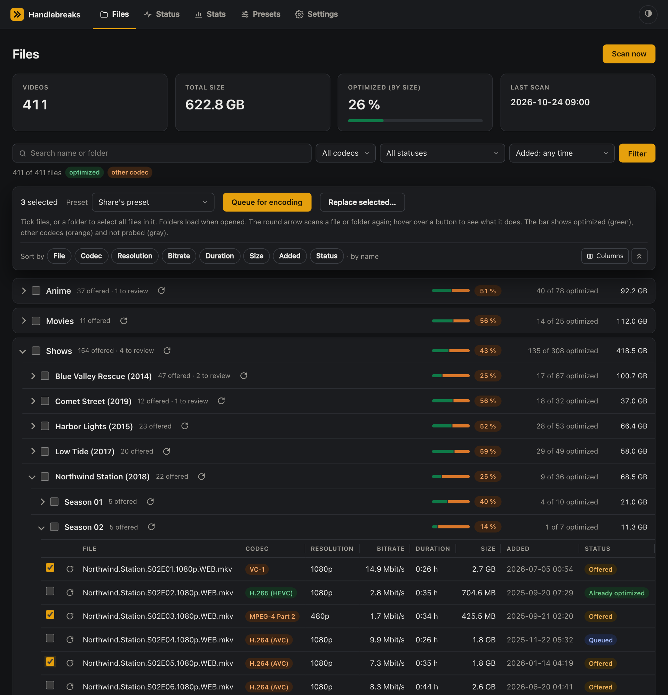

# Plex Encoding Automation (H.264 → H.265)

Semi-automatic conversion of movies and TV episodes in a Plex library from H.264 (and other older codecs) to H.265/HEVC with HandBrakeCLI. You decide which files get encoded; the tool finds candidates, queues them, encodes them in the background, and only replaces an original when you say so (keeping it as a backup by default).



*The Files page (demo data).*

## Contents

- [Quick start (Docker)](#quick-start-docker)
- [Set it up with an AI coding agent](#set-it-up-with-an-ai-coding-agent)
- [What it does](#what-it-does)
- [Choose a setup](#choose-a-setup)
- [Setup A: native on macOS](#setup-a-native-on-macos)
- [Setup B: Docker](#setup-b-docker)
- [Setup C: Docker + native encoding on a Mac](#setup-c-docker--native-encoding-on-a-mac)
- [Daily use](#daily-use)
- [Web UI](#web-ui)
- [Configuration](#configuration)
- [Files and data](#files-and-data)
- [Updating](#updating)
- [Updating from version 2.x](#updating-from-version-2x)
- [Updating from version 1.x](#updating-from-version-1x)
- [Security](#security)
- [Troubleshooting](#troubleshooting)
- [Uninstalling](#uninstalling)
- [License](#license)

## Quick start (Docker)

The fastest way to try it. Tested on macOS with Docker Desktop; Linux with Docker Engine should work the same way but isn't documented yet.

**You need:**

- [Docker Desktop](https://www.docker.com/products/docker-desktop/) (or Docker Engine with Compose), running
- Your Plex library reachable as a folder on this machine, e.g. a NAS share mounted at `/Volumes/Media` (macOS: Finder → Go → Connect to Server, `smb://nas/Media`)
- A folder with enough free space for finished encodes (the output folder). H.265 files are usually 30–60 % smaller than the H.264 originals, so plan for about half the size of what you encode at a time.
- git, or the code downloaded as a ZIP

**Steps:**

```bash
git clone https://github.com/madotha/handlebreaks.git plex-encoding-automation
cd plex-encoding-automation
cp .env.example .env
```

Edit `.env` and set two paths:

```bash
HOST_MEDIA_DIR="/Volumes/Media"                    # the folder that contains your library folders
HOST_ENCODED_DIR="/Users/you/Movies/_ENCODED"      # where finished encodes go (created if missing)
```

Then start it and open the web UI:

```bash
docker compose up -d --build
open http://127.0.0.1:7979                         # Linux: xdg-open, or just open it in a browser
```

1. **Settings → Library**: replace the two example shares with your folders. A library folder `/Volumes/Media/Movies` is `/media/Movies` inside the container. Each folder needs a green ✓.
2. **Scan now**. The first scan reads every file with ffprobe; for a large library this takes a while (roughly 30–60 minutes for 70,000 files over the network); the Status page shows that it's running. Later scans only read new or changed files. A scan saves its ffprobe results as it goes, so if it is interrupted (restart, unreachable NAS), the next scan resumes with the remaining files.
3. **Files**: tick files or whole folders and click **Queue for encoding**. Progress is on the **Status** page.
4. Check the finished files in the output folder. To put one into the library in place of the original, Docker needs write access to the library: remove `:ro` from the `/media` line in `docker-compose.yml` (or in a `docker-compose.override.yml`), then use **Replace…**. Otherwise, move the files yourself.

For more details, the native macOS setup (faster encoding) and the mixed setup, see [Choose a setup](#choose-a-setup).

## Set it up with an AI coding agent

If you use an AI coding agent that can run commands on your machine (e.g. Claude Code), you can let it do the setup. Start it in an empty folder and paste this prompt, with the repository URL filled in. It asks you for everything that depends on your environment before changing anything:

> Set up "Plex Encoding Automation" from `https://github.com/madotha/handlebreaks.git` on this machine. Clone it, read its README.md completely and follow it; don't invent steps that aren't in it.
>
> Before you install or configure anything, check my system (operating system, CPU, free disk space, and whether Docker, Homebrew, Python 3.9+, HandBrakeCLI and ffmpeg are installed), then ask me, one topic at a time:
>
> 1. Which setup to use: A (native on macOS), B (Docker) or C (Docker + native encoding on a Mac). Recommend one based on what you found and explain why in one sentence.
> 2. Where my Plex library is: the mounted folder(s), and how they're mounted (e.g. SMB or NFS from a NAS). List the subfolders you find there and ask me which ones should become shares, with which display names, and whether any share needs a different preset.
> 3. The output folder for finished encodes. Check that it exists or can be created and tell me how much free space it has.
> 4. Optional settings: Obsidian notes folder, time zone, web UI port, automatic rescan interval, and whether to connect Plex (PLEX_URL). If I want Plex, tell me how to find my Plex token, but let me paste it into config.env myself. Never print, log or repeat the token.
>
> Then install the missing requirements for the chosen setup (ask before installing anything), create `.env` and/or `config.env` from the templates with my answers, start the tool, and verify it: the web UI opens, every folder under Settings shows a green check mark, and a first scan starts. Don't queue encodes, replace files or change anything in my library; show me how to do that myself instead. Finish with a short summary: what you set up, where the config files are, and how to stop, update and uninstall it.

## What it does

1. **Scan** the library: one or more **shares** (library folders, e.g. on different NAS shares), each with a name and its own HandBrake preset. Each video is read with ffprobe (codec, resolution, duration, bitrate) and sorted:
   - already optimized: `x265`, `H.265`, `HEVC` or `FuN` in the name, or a video track in H.265 (HEVC), AV1 or H.266 (VVC) according to ffprobe
   - poor release types, filtered out: LD, MD, TS, Telesync, CAM, HDCAM, TC, Line/Mic Dubbed
   - already encoded and waiting for your review in the output folder
   - already in the queue
   - skipped by you, or part of the legacy baseline from the previous script
   - everything else: **offered** as a numbered list
2. **Choose** which files to encode: tick them on the web UI's Files page, or pass their numbers to `encoding.py queue`. Either way a batch file is written into `queue/`.
3. **Encode**: a worker picks up the batch and runs HandBrakeCLI with the preset chosen when queueing, or else the share's preset, or else the default preset. It writes to `<output>/.inprogress/` first and moves the file to the output folder only when the encode succeeded.
4. **Review** the finished files in the output folder. Until you act, they show as "awaiting review". **Replace…** in the web UI moves an encode into the library in place of its original (keeping or deleting the original) and refreshes Plex; see [Replacing originals](#replacing-originals).

Scans can also update an Obsidian note with the to-do list. Steps 1 and 2 can be automated, e.g. with a scheduled Claude task that scans regularly and asks for your selection via push notification.

| File | Purpose |
|---|---|
| `encoding.py` | Command line: scan, queue, skip, status. Stores its data in SQLite (`encoding.db`). |
| `encode.sh` | Worker: encodes everything in `queue/` with HandBrakeCLI |
| `webui.py`, `templates/`, `static/` | Web UI on port 7979 |
| `config.example.env` | Template for `config.env`, the local settings |
| `plex.py` | Plex integration: analyze an item or scan a folder after a replace |
| `presets.py` | Preset store and what the installed HandBrakeCLI supports (used by the CLI and the web UI) |
| `preset.json` | Bundled HandBrake preset (x265, RF 22, MKV, AAC 5.1), imported as the first preset on first run |
| `local.plex-encoding.plist` | launchd agent (macOS) that starts `encode.sh` when a batch appears in `queue/` |
| `local.plex-encoding-web.plist` | launchd agent (macOS) that keeps the web UI running |
| `status.sh` | Live progress view in the terminal |
| `Dockerfile`, `docker-compose.yml`, `docker-compose.hybrid.yml`, `.env.example`, `docker-entrypoint.sh` | Docker setup |

## Choose a setup

| | A: native on macOS | B: Docker | C: Docker + native encoding |
|---|---|---|---|
| Runs on | macOS | macOS (Docker Desktop) | macOS (Docker Desktop) |
| Encoding | HandBrakeCLI on the Mac, all CPU cores, Apple AAC | HandBrakeCLI 1.9 (Linux) in Docker's VM, AAC via `av_aac`, limited to the CPUs Docker Desktop may use | Native, like A |
| Web UI, scan | On the Mac (Python venv) | In the container | In the container |
| Install effort | Homebrew packages, Python venv, launchd agents | Docker Desktop and two config files | Both A and B |

If you're unsure, use **B** to try it out, or **A** for the fastest encoding. Other operating systems aren't documented yet.

## Setup A: native on macOS

### Requirements

- macOS (uses launchd, `caffeinate`, zsh, and Apple's AAC encoder `ca_aac` from the preset)
- Python 3.9 or later (`python3 --version`; the Xcode Command Line Tools or Homebrew provide it)
- [Homebrew](https://brew.sh) for HandBrakeCLI and ffmpeg (or install them manually)
- The library mounted on the Mac, e.g. as an SMB share from a NAS
- Enough free disk space in the output folder; encoded files stay there until you move them

### 1. Install the tools

```bash
brew install handbrake ffmpeg      # HandBrakeCLI and ffprobe
HandBrakeCLI --version
ffprobe -version | head -1
```

The HandBrake *app* alone isn't enough; the command-line version is a separate install. It's also available from [handbrake.fr](https://handbrake.fr/downloads2.php). Without ffmpeg the tool still works, but codec, resolution and bitrate stay empty, and only the file name decides whether a file is already H.265.

### 2. Mount the library

Connect to the share in Finder (Go → Connect to Server, e.g. `smb://nas/Media`). It then appears under `/Volumes`, e.g. `/Volumes/Media` with folders like `Movies` and `Shows` inside. NFS shares mounted elsewhere (e.g. under your home folder) work the same way. To reconnect it after a restart, add the share to System Settings → General → Login Items.

### 3. Get the code

```bash
mkdir -p ~/scripts
git clone https://github.com/madotha/handlebreaks.git ~/scripts/encoding     # or download and unpack the code there
cd ~/scripts/encoding
```

All further commands run in this folder.

### 4. Create the configuration

```bash
cp config.example.env config.env
open -e config.env
```

Set your shares (`SHARE_1`, `SHARE_2`, … with a name each, see [Shares](#shares)) and `ENCODED_DIR`, and `NOTE_DIR` if you want Obsidian notes. Each key is explained in [Configuration](#configuration). Each folder setting already lists a container path after the `:`; it doesn't hurt in a native setup. Presets are set up on first run (see [Presets](#presets)); you can manage them later in the web UI.

### 5. First scan

```bash
python3 encoding.py scan
```

The first scan reads every file with ffprobe, which can take a while over the network. Later scans only read new or changed files.

### 6. Install the web UI (optional)

```bash
python3 -m venv .venv
.venv/bin/pip install -r requirements.txt
.venv/bin/python3 webui.py           # http://127.0.0.1:7979, stop with Ctrl+C
```

### 7. Start the background services

```bash
chmod +x encode.sh status.sh
mkdir -p logs

# Encoding worker: starts as soon as a batch appears in queue/
sed "s|/Users/YOUR_USER/scripts/encoding|$PWD|g" local.plex-encoding.plist \
  > ~/Library/LaunchAgents/local.plex-encoding.plist
launchctl bootstrap gui/$(id -u) ~/Library/LaunchAgents/local.plex-encoding.plist

# Web UI (only if you did step 6): starts at login and restarts if it stops
sed "s|/Users/YOUR_USER/scripts/encoding|$PWD|g" local.plex-encoding-web.plist \
  > ~/Library/LaunchAgents/local.plex-encoding-web.plist
launchctl bootstrap gui/$(id -u) ~/Library/LaunchAgents/local.plex-encoding-web.plist
```

The `sed` command fills the plist templates with your install folder.

### 8. Allow access

The first time launchd starts the scripts, macOS may ask whether `zsh`, `HandBrakeCLI` or `python3` may access network volumes or the Downloads folder. Allow it, or grant them access under System Settings → Privacy & Security (Files and Folders, or Full Disk Access). If the worker logs "Library not reachable" even though the share is mounted, missing permissions are the usual cause.

## Setup B: Docker

### Requirements

- [Docker Desktop](https://www.docker.com/products/docker-desktop/) for Mac
- The library mounted on the Mac (see [Setup A, step 2](#2-mount-the-library))
- Docker Desktop must be allowed to read the library and the output folder. `/Users` and `/Volumes` are shared by default; check under Settings → Resources → File sharing.
- Under Settings → Resources, give Docker enough CPUs and memory. Encoding only uses what Docker Desktop allows.

### 1. Get the code and configure the paths

```bash
git clone https://github.com/madotha/handlebreaks.git plex-encoding-automation
cd plex-encoding-automation
cp .env.example .env
open -e .env
```

`.env` tells Docker which folders on the Mac to mount into the container:

| `.env` key | Mac folder | Path in the container |
|---|---|---|
| `HOST_MEDIA_DIR` | The folder that contains your shares (mounted read-only), e.g. `/Volumes/Media` | `/media` |
| `HOST_ENCODED_DIR` | Output folder | `/encoded` |
| `HOST_NOTE_DIR` | Optional: Obsidian folder | `/notes` |
| `WEB_PORT` | Optional: port on the Mac, default `7979` | `7979` |
| `WEB_BIND` | Optional: who can reach the web UI. `127.0.0.1` (default) = only this Mac; `0.0.0.0` = every device in your network, at `http://<the Mac's IP>:7979` (plain http, not https). There is no login yet, see [Security](#security). | – |
| `TZ` | Optional: time zone of the container, e.g. `Europe/Zurich` (default `UTC`). Affects logs and stored times; the web UI always shows times in your browser's time zone. | – |

Shares inside `HOST_MEDIA_DIR` are available in the container as `/media/<folder>`. A share somewhere else (another volume) needs its own mount in a `docker-compose.override.yml` next to `docker-compose.yml` (Docker Compose reads it automatically; it's gitignored):

```yaml
services:
  encoding:
    volumes:
      - /Volumes/Archive/Shows:/media/Archive:ro
```

Then add the share under **Settings → Library** with the container path (here `/media/Archive`) after the `:`, and restart with `docker compose up -d`.

### 2. Start

```bash
docker compose up -d --build
```

On first start the container creates `config.env` in its data volume, with two example shares (`/media/Movies` and `/media/Shows`), and imports the bundled preset as the default. Adjust the shares to your folders under **Settings → Library**.

### 3. Open the web UI

Open <http://127.0.0.1:7979>. Under **Settings**, check that each folder has a green ✓. Then click **Scan now**.

### 4. Queue files

On the **Files** page, tick the files you want to encode, or tick a folder to select everything in it (e.g. a whole season), then click **Queue for encoding**. Any file can be queued this way, including files the scan didn't offer.

The same works on the command line, using the numbers from the last scan:

```bash
docker compose exec encoding python3 encoding.py scan
docker compose exec encoding python3 encoding.py queue 1,3,5-8
```

The worker in the container checks the queue every 30 seconds and starts encoding. Progress appears on the **Status** page.

### Useful Docker commands

```bash
docker compose logs -f                               # container output
docker compose exec encoding zsh status.sh           # live progress in the terminal
docker compose exec encoding cat /data/logs/encode.log   # worker log
docker compose down                                  # stop (data volume stays)
docker compose up -d --build                         # update after pulling new code
```

## Setup C: Docker + native encoding on a Mac

The container runs the web UI and the scans, and the Mac keeps encoding natively with launchd. Use this to get the web UI without installing Python packages on the Mac while keeping native encoding speed.

1. Do [Setup A](#setup-a-native-on-macos) steps 1 to 4 and step 7, but install only the encoding worker (`local.plex-encoding.plist`), not the web UI agent.
2. Make sure each folder setting in `config.env` contains the Mac path and the container path, e.g. `SHARE_1="/Volumes/Media/Movies:/media/Movies"`. The template already does this.
3. Do [Setup B](#setup-b-docker) step 1 and also set `HOST_APP_DIR` in `.env` to the native install folder (e.g. `/Users/you/scripts/encoding`).
4. Start with both compose files:
   ```bash
   docker compose -f docker-compose.yml -f docker-compose.hybrid.yml up -d --build
   ```

The container and the Mac then share `config.env`, `queue/` and `logs/`. Batches queued in the container are picked up by launchd on the Mac, and the Status page shows the Mac's progress. The container never encodes in this mode.

The database is in a separate Docker volume, because SQLite must not be used from the Mac and the container at the same time through a shared folder. Run `encoding.py` only inside the container in this setup:

```bash
docker compose -f docker-compose.yml -f docker-compose.hybrid.yml exec encoding python3 encoding.py queue 1,2
```

## Daily use

```bash
python3 encoding.py scan                    # find candidates, numbered list
python3 encoding.py scan --no-probe         # faster, without ffprobe
python3 encoding.py scan --share 3          # only share 3, e.g. after adding it
python3 encoding.py scan --share 3 --force  # share 3 again from scratch: re-read every file with ffprobe
python3 encoding.py queue all               # queue everything in the list
python3 encoding.py queue 1,2,5-8           # queue by number
python3 encoding.py queue all -3 -7 --skip-rest
                                            # everything except 3 and 7, and hide those two
python3 encoding.py skip 4                  # hide a file permanently (until its name changes)
python3 encoding.py skipped                 # list hidden files
python3 encoding.py unskip 2                # show number 2 of that list again
python3 encoding.py status                  # current progress
python3 encoding.py version
zsh status.sh                               # live view, Ctrl+C ends only the view
```

In Docker, prefix each command with `docker compose exec encoding`. The numbers always refer to the list from the latest scan.

## Web UI

The web UI works on desktop and on phones: on a phone, the pages are in a tab bar at the bottom, file lists show compact two-line rows (tap a file name for bitrate, duration and date added), and dialogs open from the bottom. Light and dark mode follow your system; the button at the top right switches between system, light and dark (remembered by the browser).

| Page | Content |
|---|---|
| **Files** | All scanned videos as a folder tree with codec, resolution, bitrate, duration, size and status. Folders load their content when opened, and **Collapse all** closes every open folder; long lists show 100 subfolders (**Show more folders**) and 200 files (**Show more**) at a time, so the page stays fast with tens of thousands of files. Codecs are color coded: green for optimized codecs (H.265, AV1, H.266), orange for all others. Every folder shows how many of its files are already optimized, with a green/orange bar and a percentage badge (green when the whole folder is optimized). Totals and the optimized share at the top. Sort with the **Sort by** buttons at the top of the list (they stay visible while scrolling) or the column headers of an opened folder: file name, codec, resolution, bitrate, duration, size, date added, status; each click cycles ascending, descending, off (default order by name); folders follow the sort for size (folder size) and status (optimized share), otherwise they stay sorted by name, and files without a value (not probed) come last. Folders only open when you click them; every page load starts with all folders collapsed. Filters: text search, status, date added (last 24 hours, 7 days, 30 days, or a custom range picked with date pickers; "added" is when a scan first found the file, for older files their file date), and a codec filter that combines any of the codecs found with the groups "All optimized codecs" and "All other codecs". With a filter active, the folders show how many of their files match. Select files or whole folders (they don't need to be opened); to select several files at once, click the first, then Shift+click the last, or press on a checkbox and drag over the rows (this works for every list with checkboxes, also on the Status page). Then click **Queue for encoding**; a folder queues all its files that match the active filters. The round-arrow button next to every file and folder scans just that file or folder again (re-reading it with ffprobe), e.g. to check a file after replacing it. The file being encoded shows the status **Encoding**, and an offered file whose last encode failed carries a red **Failed** marker until it is encoded successfully. Files awaiting review have a **Replace…** button (the arrows icon; hover over any icon button to see what it does), see [Replacing originals](#replacing-originals). |
| **Status** | (Lists here and on other pages sort by clicking a column header, on phones with the **Sort by** buttons: ascending → descending → off; the sort is remembered across pages and reloads.) Current encode with progress, fps and time left, and three tabs with live counts: **Queue** (encoding, waiting and removed entries with their preset), **Awaiting review** (finished encodes that wait for **Replace…**, also from earlier runs) and **History** (every encode result — done, failed, stopped, missing, already exists — and every finished replace, newest first, filterable by result). Progress and counts update live every 3 seconds without reloading; the lists show 100 entries at a time and reload when the next file starts or on **Refresh** — so they stay fast with thousands of entries. Every row in every tab can be ticked. While a file encodes, **Stop, continue with next** ends it and goes on with the queue, and **Stop all** ends it and pauses the queue until **Resume** (both delete the partly encoded file; the file is offered again). Waiting entries in the Queue tab can be reordered (drag the handle of a row, the up/down arrows, or **Move to top** / **Move to bottom** for the ticked rows; not while a column sort is on) and removed (**Remove selected**, **Remove all waiting**). A divider marks where the next run starts: entries of the run in progress stay where they are, and moving one of them puts it and everything after it into a new batch, which a new worker run starts when the current run is finished (the old places show "Removed" and are skipped). Presets chosen when queueing are kept. Awaiting review offers **Replace…** per entry, **Replace selected…** and **Replace all finished…**. In History, failed or stopped files get **Queue again** (per row or for the selection; the file is queued with the preset it had). **Dismiss selected**, **Dismiss all shown** and **Dismiss** entries older than 1, 7 or 30 days only hide entries on this page; nothing is deleted, a new result of the same file shows again, and a failed file keeps its Failed marker on the Files page until it is encoded successfully. Entries older than `HISTORY_KEEP_DAYS` (30 by default) are hidden automatically. **Delete history data…** forgets all results, dismissals and replace results and deletes finished batch files and logs of failed encodes (encoded files are not touched). Also the scan state and the automatic rescan schedule. |
| **Stats** | Key figures (optimized share, size still to optimize, median bitrates) and charts of the distribution by codec (count and storage), bitrate, file size, resolution, library folder and status. Every chart has a table view, and hovering a bar shows its values. |
| **Settings** | The values from `config.env`, in separate sections (Library, Encoding, Obsidian, Worker). Each folder shows whether it exists. Changes apply immediately. |

There is **no login yet**. The web UI therefore listens on `127.0.0.1` only, and `docker-compose.yml` publishes the port only on `127.0.0.1`. Don't make it reachable from other machines until login is implemented. Values entered in the settings may use `$HOME`, but no other `$`, quotes or backslashes, because `config.env` is read by the shell.

## Configuration

### `config.env`

All machine-specific settings live in `config.env` in the data folder. It is created from `config.example.env` and stays out of git. You can edit it with a text editor or in the web UI.

| Key | Meaning |
|---|---|
| `SHARE_1`, `SHARE_2`, … | The shares (library folders) to scan, read only. See [Shares](#shares). |
| `SHARE_N_NAME` | Name of share N, shown everywhere. Defaults to the folder name. |
| `SHARE_N_PRESET` | Preset id for share N. Empty = `DEFAULT_PRESET`. |
| `DEFAULT_PRESET` | Preset id used for shares without their own. See [Presets](#presets). |
| `ENCODED_DIR` | Output folder for finished files, created if missing |
| `NOTE_DIR` | Obsidian folder for "Encoding To-Do.md" and "Encoding Status.md". Leave empty to skip notes. |
| `STATUS_NOTE_ENABLED` | `1` updates the status note every minute while encoding; `0` turns it off |
| `FFPROBE_WORKERS` | How many files ffprobe reads at the same time during scans. Empty (default) = number of CPUs. Lower it if the NAS struggles during scans. |
| `HISTORY_KEEP_DAYS` | How many days the Status page's History shows results and finished replaces. Older entries are only hidden, nothing is deleted. `30` (default); `0` = always show. |
| `SCAN_INTERVAL` | Automatic rescan of all shares, in **minutes**: a scan starts once the last scan is that old. `0` (default) = off. See [Automatic rescan](#automatic-rescan). |
| `WORKER_ENABLED` | Docker only: `1` encodes in the container, `0` only runs web UI and scans |
| `RENAME_CODEC_TAGS` | Tag per codec for the name suggested by **Replace…**, as `codec=tag` pairs. Empty = `hevc=x265 av1=AV1 vvc=VVC h264=x264`. |
| `RENAME_QUALITY` | `1` (default) adds the encode's quality after the release group in the suggested name: `.rf20` for constant quality, `.avg2000` for average bitrate. `0` = off. |
| `RENAME_GROUP` | Optional: your release group, replacing the original one after the codec tag in the suggested name (e.g. `donm`). Empty = keep it. |
| `PLEX_URL`, `PLEX_TOKEN` | Optional: Plex server address(es) and token, so Plex is refreshed after **Replace…**. See [Connecting Plex](#connecting-plex). |

Write values in double quotes and use `"$HOME"` rather than `~`. A folder setting can list several paths separated by `:`, and the first one that exists is used. That way one `config.env` works on the Mac and in the container.

### Automatic rescan

Set `SCAN_INTERVAL` to a number of minutes (in the web UI under **Settings → Scans**, or in `config.env`) to rescan all shares automatically, e.g. `SCAN_INTERVAL=30` for every 30 minutes. `0` turns it off, which is the default.

- The web UI checks once a minute whether the last scan (manual or automatic) is at least that old, and then starts a normal scan of all shares: only new or changed files are read with ffprobe. A rescan of an unchanged library mostly costs walking the folders (about 2–3 minutes for 70,000 files over NFS).
- It runs inside the web UI process, so it works whenever the web UI runs: always in Docker, and natively when the web UI's launchd agent is installed. Without the web UI, schedule `python3 encoding.py scan` yourself (e.g. a launchd job with `StartInterval` or a cron job).
- If a scan is already running, the automatic one waits for the next check. Changes to the interval apply within a minute, no restart needed.
- The **Status** page shows when the next automatic scan is due.

### Shares

The library consists of shares: folders that are scanned (read only), each with a name and a preset. There's no fixed split into movies and TV shows; use as many shares as your library has folders. Manage them in the web UI (**Settings → Library**) or in `config.env`:

```bash
SHARE_1="/Volumes/Media/Movies:/media/Movies"
SHARE_1_NAME="Movies"
SHARE_1_PRESET=""                                 # empty = DEFAULT_PRESET
SHARE_2="/Volumes/Media/Anime:/media/Anime"
SHARE_2_NAME="Anime"
SHARE_2_PRESET="anime-x265-10bit"                 # a preset id, see Presets
```

- Each share appears as its own top-level folder in the web UI and in the stats.
- **Scanning a single share:** under **Settings → Library**, a new share has an **Initial scan** button, and every scanned share has a **Full rescan** button that re-reads all its files with ffprobe (e.g. after files were replaced without their size or date changing). Both only touch that share; the other shares keep their data. **Scan now** on the Files and Status pages scans all shares, and only reads new or changed files with ffprobe. The Files page lists shares that haven't been scanned yet.
- The `:` separates fallback paths of the *same* folder (Mac path, container path), not different folders.
- **Keep each share's number.** It is part of how files are stored in the database (skipped files, results, the queue), so renaming a share is fine but renumbering isn't. To remove a share, comment its lines out (the web UI does this when you clear its folder); a commented-out number is never reused.
- All shares must be reachable for a scan and for the worker to start, so a disconnected share never makes files disappear from the list.
- Finished files from all shares land in the same output folder. Two files with the same name from different shares can't both be there: the second one is logged as `EXISTS`.

### Presets

HandBrake presets are managed on the web UI's **Presets** page:

- **Create** a preset from any of HandBrake's built-in presets, as a copy of an existing one, or by importing a file exported from the HandBrake app (Presets → Export; files with several presets or preset folders are imported completely).
- **Edit** every setting in a form with the tabs of the HandBrake app: **Summary** (name, container, web optimized, metadata, chapters), **Dimensions** (crop, maximum or forced size, upscaling, anamorphic, modulus, rotation and flip, borders), **Filters** (detelecine, interlace detection, deinterlace, denoise, chroma smooth, sharpen, deblock, color space, grayscale, each with preset, tune or custom parameters), **Video** (encoder, speed, tune, profile, level, RF or bitrate with multi-pass, frame rate and mode, extra encoder options, hardware decoding, scaler), **Audio** (track selection, languages, allowed passthru, fallback encoder, and any number of tracks with encoder, mixdown, sample rate, bitrate or quality, gain, DRC, compression, dither) and **Subtitles** (selection, languages, foreign audio search, closed captions, burn-in). Settings the editor has no field for (e.g. from a newer HandBrake) appear under **More**. The full JSON stays available for anything else. HandBrakeCLI checks a preset before it's saved, and saving an unchanged form changes nothing.
- **Export** a preset as a HandBrake file, **make it the default**, or **delete** it (not while it's the default, assigned to a share, or used by queued files).

The editor shows which HandBrakeCLI encodes (version and platform) and notes what won't work with it: settings it doesn't know (e.g. from a newer HandBrake app, marked "ignored by the worker"), values it doesn't offer, and options tied to a platform or hardware ("macOS only" for VideoToolbox and Apple AAC, "Windows only" for Media Foundation, "needs an NVIDIA GPU" …). In the mixed setup (Docker web UI, encoding on the Mac), the Mac's worker publishes what its HandBrakeCLI supports when it starts, and the editor uses that instead of the container's older HandBrakeCLI. `python3 encoding.py preset-check` prints the same as a report for all presets. The choices in the editor and the list of built-in presets come from the HandBrakeCLI that encodes, so they always match its version: newer HandBrake versions bring their new encoders and presets along automatically. Without HandBrakeCLI (e.g. a web UI on a machine that doesn't encode), the editor offers a generic list and can't check presets.

Which preset a file gets:
1. the preset chosen when queueing (Files page: **Preset** next to **Queue for encoding**; CLI: `queue … --preset <id>`),
2. otherwise the share's preset (`SHARE_N_PRESET`),
3. otherwise `DEFAULT_PRESET`.

Presets are stored as HandBrake export files in `presets/` in the data folder, named by their id (e.g. `presets/1080p-x265-ger-eng-rf20.json`). The id is fixed when a preset is created, so renaming a preset doesn't affect shares or queued files. The output file's extension follows the preset's container (`.mkv`, `.mp4`, `.webm`).

### Replacing originals

Finished encodes wait in the output folder for your review. When you're happy with one, click **Replace…** next to the original on the **Files** page, or next to the finished entry on the **Status** page (tab **Awaiting review**; replaced files move to **History** as "Replaced"):

1. Choose the file name. It's pre-filled with a suggestion: the original name with its codec tag (`h264`, `x264`, `H.264`, `AVC`, `XviD` …) changed to the encode's codec, e.g. `…WEB.h264-NTB.mkv` → `…WEB.x265-NTB.mkv`. Names without a codec tag get it before the release group (`…WEBRip-LAMA` → `…WEBRip.x265-LAMA`); others keep their name. With `RENAME_GROUP` set, the release group is replaced with yours, and the quality of the preset the file was encoded with follows it (`…x265-donm.rf20.mkv`, or `…x265-donm.avg2000.mkv` for an average bitrate preset; `RENAME_QUALITY=0` turns that off). The extension follows the encoded container (e.g. `.mp4` → `.mkv`). Edit the name as you like; with the same name Plex analyzes the item again, with a new name it scans the folder.
2. Choose whether to keep the original in `<output folder>/.replaced/` (default, same folder structure as in the share) or delete it.
To replace several files at once, tick them (or whole folders) on the **Files** page and click **Replace selected…**, or tick entries in **Awaiting review** on the **Status** page and click **Replace selected…**, or click **Replace all finished…** there. The list shows every file with a finished encode and its suggested name, which you can edit per file; Plex is then refreshed once per folder.

3. **Move and replace**: the encode is moved into the original's folder under the chosen name, and the original is moved away or deleted. The page shows the result. The replace is a job on the server: it finishes even if you reload or leave the page (the file shows **Replacing…** until then), and the web UI checks the folder afterwards on its own, so the list shows the new file either way.

The move is done by the worker (`encode.sh`), because the web UI may not be allowed to write to the library (in Docker it's mounted read-only): natively with launchd, or in the container if its library mount is writable. It also runs while an encode is in progress. It never overwrites another file, retries if the NAS briefly refuses the move, and puts the original back if the move fails.

**Plex:** with `PLEX_URL` and `PLEX_TOKEN` set (see below), the worker tells Plex right after the move: for the same file name it has Plex **analyze** that movie or episode (a library scan wouldn't notice a same-name replacement, and Plex would keep showing the old codec); for a new name or extension it has Plex **scan just that folder**. The result appears in the replace message. Without them, do it by hand: **Analyze** the item, or **Scan Library Files** with "Empty trash automatically after every scan" turned off, so the item keeps its watch history. Delete the backups in `.replaced/` once you're happy.

#### Connecting Plex

1. Get the token of your Plex server. On the Mac running Plex Media Server: `defaults read com.plexapp.plexmediaserver PlexOnlineToken`. Or in Plex Web: an item → ⋯ → Get Info → View XML, the address ends in `X-Plex-Token=…`. Treat it like a password.
2. Add to `config.env` (gitignored; the token isn't editable or shown in the web UI):
   ```bash
   PLEX_URL="http://127.0.0.1:32400"
   PLEX_TOKEN="…"
   ```
   In the mixed setup (Setup C), list both addresses, the Mac's and the one seen from the container: `PLEX_URL="http://127.0.0.1:32400 http://host.docker.internal:32400"`. The first that answers is used.
3. **Settings → Plex** shows whether the connection works and which Plex libraries match your shares.

The files must have the same paths for the worker as in your Plex libraries, which is the case when the worker runs on the Plex server's Mac with the same mounts.

### Environment variables

| Variable | Default | Meaning |
|---|---|---|
| `ENCODING_DATA_DIR` | the program folder (Docker: `/data`) | Where `config.env`, `encoding.db`, `queue/`, `logs/` etc. live |
| `ENCODING_DB_FILE` | `$ENCODING_DATA_DIR/encoding.db` | Database file. It must be on a local disk, not on a network share. |
| `WEB_HOST`, `WEB_PORT` | `127.0.0.1`, `7979` (Docker: `0.0.0.0` inside the container) | Address of the web UI; also `webui.py --host/--port` |
| `WORKER_ENABLED` | not set | Docker only: overrides `WORKER_ENABLED` from `config.env` (set to `0` by `docker-compose.hybrid.yml`) |

## Files and data

Everything the tool creates lives in the data folder (the program folder, or `/data` in Docker):

| Path | Content |
|---|---|
| `config.env` | Your settings |
| `encoding.db` | SQLite database: file inventory with ffprobe data, skipped files, legacy baseline, last numbered list, encode results, entries dismissed on the Status page |
| `queue/`, `processing/`, `done/` | Batch files: waiting, being encoded, finished |
| `logs/encode.log` | Worker log |
| `logs/results.tsv` | One line per encoded file (OK, FAIL, MISSING, EXISTS, STOPPED); copied into the database |
| `logs/fail-*.log` | HandBrake log of a failed encode |
| `logs/encodes.tsv` | Preset and quality of every finished encode (for the suggested file name) |
| `handbrake-worker.json` | What the encoding worker's HandBrakeCLI supports, for the preset editor |
| `logs/launchd.log`, `logs/webui.log` | Output of the launchd agents (Setup A) |
| `replace/`, `replace/done/` | Replace jobs from the web UI and their results |
| `cancelled.txt` | Entries removed from the run in progress (skipped by the worker, deleted when the run ends) |
| `stop.txt`, `paused` | A stop request for the running encode, and the pause after **Stop all** (deleted by **Resume**) |
| `.handbrake-cache.json` | HandBrakeCLI's encoders and built-in presets, read again when HandBrakeCLI changes |

## Updating

Check [CHANGELOG.md](CHANGELOG.md) for what changed, and the sections below for releases that need manual steps. Your data (`config.env`, `encoding.db`, presets, queue, logs) is kept; database and config changes are migrated automatically on the first run.

**Native (Setup A):**

```bash
cd ~/scripts/encoding
git pull
.venv/bin/pip install -r requirements.txt                       # if you use the web UI
launchctl kickstart -k gui/$(id -u)/local.plex-encoding-web     # restart the web UI
```

The worker picks up the new `encode.sh` with its next run. If a release changed the plist templates (the changelog says so), install them again as in [Setup A, step 7](#7-start-the-background-services), after `launchctl bootout gui/$(id -u)/local.plex-encoding` (and `…-web`).

**Docker (Setups B and C):**

```bash
cd plex-encoding-automation
git pull
docker compose up -d --build       # Setup C: docker compose -f docker-compose.yml -f docker-compose.hybrid.yml up -d --build
```

In Setup C, also update the native installation as above, since the Mac's worker runs from it.

## Updating from version 2.x

Version 3 replaces the movie/TV show folders with shares and adds the preset store. The update is automatic: on the first run (any `encoding.py` command, or opening the web UI):

- `MOVIES_DIR`, `MOVIES_DIR_2`, …, `SHOWS_DIR`, `SHOWS_DIR_2`, … become `SHARE_1`, `SHARE_2`, … in that order, named after their folders. The old lines are commented out, and the previous file is kept as `config.env.v2.bak`.
- The preset from `PRESET_FILE`/`PRESET_NAME` is imported into the preset store and becomes `DEFAULT_PRESET`.
- All stored data moves to the new share keys: skipped files, results, the last numbered list, the file inventory (no new ffprobe pass needed), and batches still waiting in the queue.

Two things to do by hand: run `encoding.py` once (or open the web UI) before the native worker picks up a new batch (it waits and logs a hint until then), and in Docker replace `HOST_MOVIES_DIR`/`HOST_SHOWS_DIR` in `.env` with `HOST_MEDIA_DIR` (the folder that contains your shares), then adjust the container paths of the shares under **Settings → Library**.

## Updating from version 1.x

1. Let the queue run empty first (`queue/` and `processing/` contain no batch files). Batches from 1.x use the old German key prefixes, which the new worker no longer accepts.
2. Create `config.env` from `config.example.env` and set your library folders as shares (`SHARE_1`, …; they used to be in `encoding.py` and `encode.sh`).
3. On the first run, `state.json` is imported into `encoding.db` automatically and renamed to `state.json.migrated`. Your skipped files, legacy baseline and last list are kept, and old entries in `logs/results.tsv` are imported too.
4. Scripts that call the tool need two changes: `queue alle` is now `queue all`, and `scan --json` uses English field names (`offer`, `queued`, `awaiting_review`, …).
5. The launchd agent is now named `local.plex-encoding`. Remove the old one and install the new one as in [Setup A, step 7](#7-start-the-background-services):
   ```bash
   launchctl bootout gui/$(id -u)/<old label>
   rm ~/Library/LaunchAgents/<old plist file>
   ```

## Security

- The web UI has **no login** yet. By default it only listens on `127.0.0.1` (natively and through Docker's port mapping), so only the machine itself can reach it. `WEB_BIND=0.0.0.0` in `.env` (Docker) or `webui.py --host 0.0.0.0` (native) opens it to your network; then anyone there can use it, so only do that on a trusted network. Never expose it to the internet: for remote access use a VPN such as Tailscale, a reverse proxy with authentication, or an SSH tunnel. It serves plain `http`; `https` needs a reverse proxy.
- All forms are protected against cross-site requests (CSRF token per session).
- `config.env` and `.env` contain your paths and, if set, the Plex token. Both are gitignored; keep them that way. The web UI never shows the token.
- The tool never modifies originals unless you click **Replace…**, and even then it keeps the original by default (in `<output folder>/.replaced/`).

## Troubleshooting

| Problem | Check |
|---|---|
| `config.env is missing` | Create it: `cp config.example.env config.env` |
| `Movies, Shows not reachable. Is the NAS mounted?` (share names) | Is the share mounted? Do the paths in `config.env` (or `.env` for Docker) match? |
| Worker logs `Library not reachable` although the share is mounted | macOS privacy permissions for launchd jobs, see [Setup A, step 8](#8-allow-access) |
| `HandBrakeCLI not found` | Install HandBrakeCLI (not just the app) to `/opt/homebrew/bin` or `/usr/local/bin` |
| Codec and bitrate stay empty | Install ffmpeg (`brew install ffmpeg`), then scan again |
| An encode failed | `logs/fail-<date>.log` contains HandBrake's log |
| Docker: folders show ✗ in the settings | Paths in `.env` and Docker Desktop file sharing |
| `A scan is already running.` | Wait for the other scan (web UI or terminal) to finish |

## Uninstalling

```bash
launchctl bootout gui/$(id -u)/local.plex-encoding
launchctl bootout gui/$(id -u)/local.plex-encoding-web
rm ~/Library/LaunchAgents/local.plex-encoding*.plist
docker compose down -v          # Docker: also deletes the data volume
```

Then delete the program folder. Your library is never modified, and encoded files stay in the output folder.

## License

[MIT](LICENSE)
